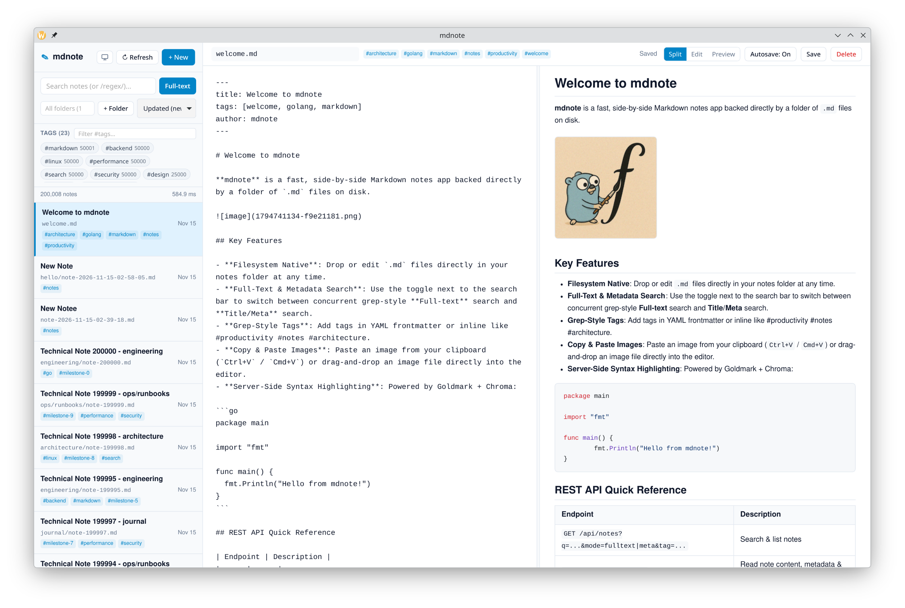

# mdnote

A GUI (WebUI in the browser or Desktop app) to turn a folder with Markdown files into a full side-by-side Markdown notes application, if and when you need it.



All operations in the UI happen in the filesystem. There's no database, no special state. You can edit your `.md` files outside the app without causing issues. There's not even a search index - for features like search or tags the app "greps" the files.

Features: Fast (scales to thousands of notes), Side-by-side Markdown editor, paste images, subfolders, tabs, pop out note to new window, auto-save (can get disabled), tags, search (full text or metadata search, with optional regex support), search/replace in notes (with optional regex), sorting, code syntax highlighting, frontmatter support (optional), copy a note's filepath to the clipboard, REST API with auth, light/dark theme.

Choose between viewing the GUI in the browser (`mdnote`) or using a Desktop app (`mdnote-gui`, [Wails](https://wails.io/) based).

Local only. If you need sync, just put your notes dir on Dropbox, git, syncthing, etc. Intentionally no MCP server - just point your agent at your notes dir (your agent should be good enough at grepping your notes files on its own).

## Installation

Download [release binaries](https://github.com/christian-korneck/mdnote/releases/latest).

If you want to use the native GUI app on Linux, make sure that you have `gtk4` and `webkitgtk6` installed.

Ubuntu/Debian:
```
sudo apt install libgtk-4-1 libwebkitgtk-6.0-4
```

Fedora/EL:
```
sudo dnf install gtk4 webkitgtk6.0
```

## Usage

Point `mdnote` or `mdnote-gui` to a folder. Potentially existing `.md` files in it will be treated as notes. New notes will get created in it.

## Either: UI in the browser

To view the UI in the browser use `mdnote` and open `http://localhost:9090`

```
mdnote ./notes
```

## Or: Desktop app

Alternatively, to get a native GUI window, use `mdnote-gui`:

```
mdnote-gui ./notes
```


## Config File

This app has no state of its own - all changes happen in the Markdown files. However, a few GUI preferences (like auto-save on/off, dark/light mode selection, etc) automatically persist via a config file:

- Linux: ~/.config/mdnote/config.json (or $XDG_CONFIG_HOME/mdnote/config.json)
- macOS: ~/Library/Application Support/mdnote/config.json
- Windows: %AppData%\mdnote\config.json

## Building from source

### `mdnote` (webui)

```
# Build the server: a fully static, cgo-free binary
CGO_ENABLED=0 go build -o mdnote ./cmd/mdnote
```

### `mdnote-gui` (Wails-based Desktop app)

On Linux/MacOS (CGO):

```bash
# Linux build dependencies (GTK4 + WebKitGTK 6.0):
#   Fedora:        sudo dnf install gtk4-devel webkitgtk6.0-devel
#   Debian/Ubuntu: sudo apt install libgtk-4-dev libwebkitgtk-6.0-dev
go build -tags production -ldflags "-s -w" -o mdnote-gui ./cmd/mdnote-gui
```

On Windows (CGO-free):
```bash
CGO_ENABLED=0 GOOS=windows GOARCH=amd64 go build -trimpath -tags production -ldflags "-s -w" -o mdnote-gui.exe ./cmd/mdnote-gui
```

## REST API

When `mdnote` is running, there's also a REST API available (not available with `mdnote-gui`).

### API auth

The API is authenticated. By default, a random token is created on every `mdnote` start and printed in the terminal. You can also define your own secret with `-api-token <token>`, env var `MDNOTE_API_TOKEN` or `"apiToken": "<token>"` in the [config file](#config-file).

### Example

```
curl -H "Authorization: Bearer my-secret-here" http://localhost:9090/api/notes
```


### API specs

| Method & Path | Description |
| :--- | :--- |
| `GET /api/notes` | Search & list notes (`q`, `mode=fulltext\|meta`, `tag`, `folder`, `sort`, `limit`, `offset`) |
| `POST /api/notes` | Create a new note (`{"path": "folder/note.md", "content": "# Hello"}`) |
| `POST /api/notes/rename` | Move or rename a note (`{"oldPath": "a.md", "newPath": "b.md"}`) |
| `GET /api/notes/{path...}` | Get raw Markdown, parsed metadata/tags, and rendered HTML |
| `PUT /api/notes/{path...}` | Create or update a note at `{path}` (`{"content": "..."}`) |
| `DELETE /api/notes/{path...}` | Delete a note at `{path}` |
| `POST /api/render` | Render raw Markdown to syntax-highlighted HTML (`{"content": "...", "path": "folder/note.md"}`; `path` is optional and resolves relative image links) |
| `POST /api/refresh` | Clear the metadata cache and rescan the notes directory |
| `GET /api/tags` | List all tags and their note counts |
| `GET /api/folders` | List all folders in the notes workspace |
| `POST /api/folders` | Create a folder (`{"path": "projects/new-folder"}`) |
| `POST /api/assets` | Upload an image into the folder of `notePath` (`multipart/form-data` field `file`, or raw body with `?filename=`; pass `notePath` as a query or form field) |
| `GET /assets/{path...}` | Serve files from the notes directory (used for images referenced by notes) |

